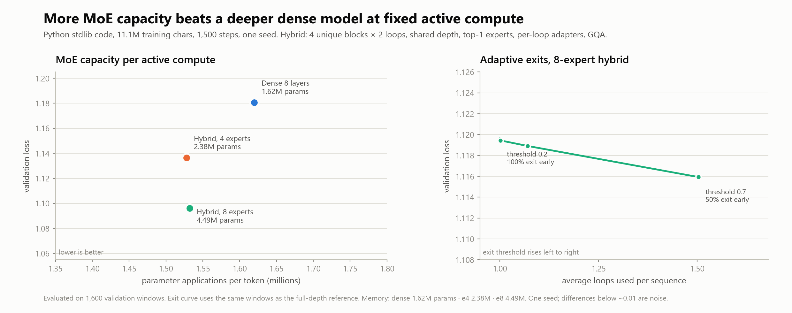

# Hybrid MoE Language Models

Research code for scaling language-model depth without paying full sequential compute,
while adding capacity that keeps paying off. The repository studies three levers:

1. **Sparse Mixture-of-Experts (MoE)** for more parameters at fixed active MLP compute.
2. **Shared depth** (reusing blocks across loops) for cheaper parameter memory.
3. **Adaptive exits and KV-cached decoding** for lower average inference compute.

The main experiment trains character-level language models on Python source code.
Smaller controlled experiments on MLPs, matrix-shaped layers, image grids, and
transformers are included to motivate each design choice.

## Key results

Code language modeling on 11.1M characters of Python standard-library source.
One NVIDIA T4 on Modal, 1,500 AdamW steps, one seed.

| Model | Total params | Unique active params | Applications/token | Val loss | Decode tok/s, T4, 64 new tokens (cached / uncached) |
|---|---:|---:|---:|---:|---:|
| Dense, 8 layers | 1.62M | 1.62M | 1.62M | 1.1806 | 87.0 / 84.6 |
| Hybrid, 4 experts | 2.38M | 0.80M | 1.53M | 1.1364 | 67.9 / 53.7 |
| Hybrid, 8 experts | 4.49M | 0.80M | 1.53M | **1.0962** | 62.1 / 40.5 |

Hybrid model: 4 unique blocks × 2 loops, RoPE, causal GQA, top-1 MoE,
per-loop adapters, exit supervision at every loop.

Findings:

- **More MoE capacity wins at fixed active compute.** Going from 4 to 8 experts
  improves validation loss by 0.040 with nearly unchanged active compute per token.
  The 8-expert model beats a dense 8-layer model by 0.084 while using slightly fewer
  parameter applications per token.
- **Depth still plateaus.** The second shared loop buys only about 0.008 validation
  loss. Extra sequential depth is not where the gains are at this scale.
- **Adaptive exits recover most of the depth at half the loops.** On the 8-expert
  model, an exit threshold of 0.2 uses one loop for 100% of validation windows and
  scores 1.1195 versus 1.1122 for full depth on the same batches. A threshold of 0.7
  uses 1.50 loops on average with 50% of windows exiting after one loop, scoring 1.1159.
- **KV cache helps decode throughput.** At 64 generated tokens on T4, cached decoding
  is 26% faster for the 4-expert model and 53% faster for the 8-expert model.

Validation numbers are from a 50-batch re-evaluation (1,600 windows). The first
10-batch evaluation during training was noisy enough to change the ranking, so
the saved checkpoints were re-scored. See [RESULTS.md](RESULTS.md) for methodology,
the full experiment history, and caveats. One seed only; treat differences below
about 0.01 as noise.



## Model

```
input tokens
  -> token embedding  (RoPE, no absolute position table)
  -> 4 unique transformer blocks, applied twice each
       attention: causal grouped-query attention, 4 query heads / 2 KV heads
       MLP: 8 experts, top-1 routing, load-balance and router z-loss
       adapter: per-loop, per-block zero-initialized bottleneck
  -> LayerNorm + tied LM head
  -> logits after each loop (training supervises every exit)
```

Active MLP compute stays at one expert per token. Exit decisions are made from
the mean maximum softmax probability over the prompt or validation window.
During cached generation, depth is frozen for the sequence so every loop's KV
cache remains valid.

## Repository map

| Path | Purpose |
|---|---|
| `hybrid_lm.py` | Hybrid MoE model, training, exit calibration, cached generation |
| `modal_run.py` | Modal sweep: dense 8-layer, 4-expert and 8-expert hybrids on T4 |
| `evaluate_hybrids.py` | Re-score checkpoints with 1,600 validation windows |
| `plot_modal_sweep.py` | Build the scaling and exit figure |
| `language_model.py` | Baseline char/BPE GPT with RoPE and causal attention |
| `sample_language_model.py` | Load a baseline checkpoint and generate text |
| `mlp.py`, `plot_mlp.py`, `depth_experiment.py` | MLP implementation and depth study |
| `matrix_mlp.py`, `matrix_experiment.py` | Matrix-shaped layers, local vs row/column mixing |
| `spatial_test.py` | Translation-generalization test: dense vs local grid |
| `transformer_test.py` | Absolute vs relative vs no positional information |
| `scripts/build_code_corpus.py` | Rebuild the Python stdlib code corpus locally |
| `data/code_split.json` | Exact public file split for the code corpus |
| `scripts/download_wikitext.py` | Fetch WikiText-2 for optional natural-language runs |
| `results/` | Figures, metrics JSON, generated samples |

## Quickstart

Python 3.11+ and PyTorch 2.5+.

```bash
python -m venv .venv
# Windows: .venv\Scripts\activate
source .venv/bin/activate
pip install -r requirements.txt

python scripts/build_code_corpus.py
python hybrid_lm.py --name hybrid_e8 --experts 8 --steps 1500
```

The command above reproduces the 8-expert configuration. The training script writes
a checkpoint, metrics JSON, an exit calibration table, and a generated code sample.

Reproduce the cloud sweep:

```bash
python -m modal run modal_run.py
python -m modal volume get --force hybrid-lm-code-results hybrid_e8.pt .
python -m modal volume get --force hybrid-lm-code-results hybrid_e4.pt .
python -m modal volume get --force hybrid-lm-code-results dense8.pt .
python evaluate_hybrids.py \
  --checkpoints dense8=modal_dense8.pt hybrid_e4=modal_hybrid_e4.pt hybrid_e8=modal_hybrid_e8.pt
python plot_modal_sweep.py
```

On Windows, prefix Modal commands with `PYTHONUTF8=1 PYTHONIOENCODING=utf-8`
if the console cannot print Modal's checkmark glyphs.

## Data and licensing

No raw corpora or model checkpoints are committed. No user data, credentials, or
private source code were used. The corpus is built from the public Python standard
library.

- **Python stdlib code corpus** is generated locally by
  `scripts/build_code_corpus.py` from the Python installation. The source is
  distributed under the Python Software Foundation License; the script does not
  redistribute it.
- **WikiText-2** is optional and fetched by `scripts/download_wikitext.py` from
  Hugging Face (`Salesforce/wikitext`). See its dataset card and license; it is not
  redistributed here.
- **Tiny Shakespeare**, used by the small natural-language demo, is public domain
  and downloaded at runtime from the URL in `language_model.py`.

Code is MIT licensed. Figures in `results/` were generated by the scripts in this
repository. Model outputs in `results/` are synthetic text and contain no private
data.

## Limitations

- One seed per configuration. The hybrid 8-expert advantage over 4 experts is larger
  than observed seed noise elsewhere, but is not a multi-seed result.
- Character-level tokenization and 11.1M training characters. This is not a
  competitive language model; absolute losses are not meaningful outside the setup.
- "Active compute" is parameter applications per token, an approximation to FLOPs.
  It does not account for attention sequence costs or hardware utilization.
- Shared depth plateaus quickly here. The adaptive exit result shows how to avoid
  paying for the second loop, not that extra depth helps.
- The saved checkpoints were produced by a single Modal T4 run. Full hyperparameter
  search, BPE tokenization, and longer training are open next steps.

## Contact

Open a GitHub issue for questions or reproducibility problems.
